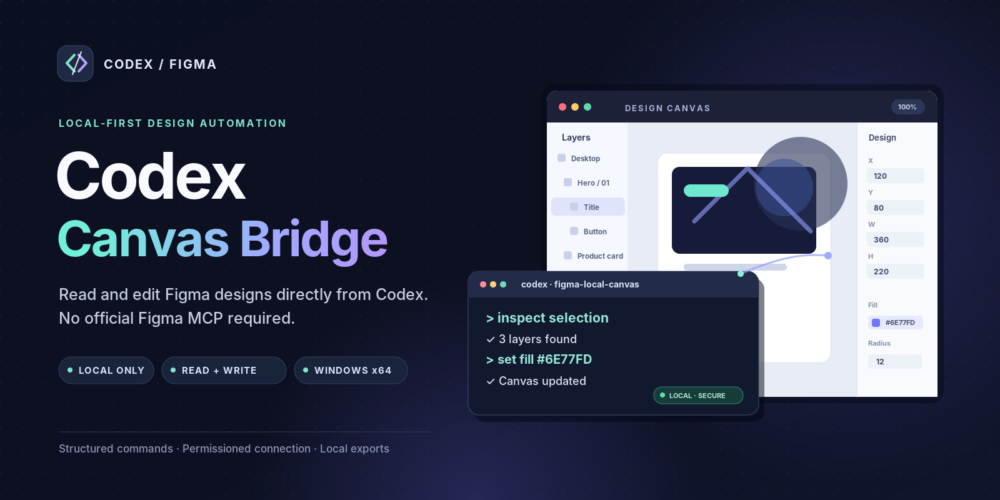
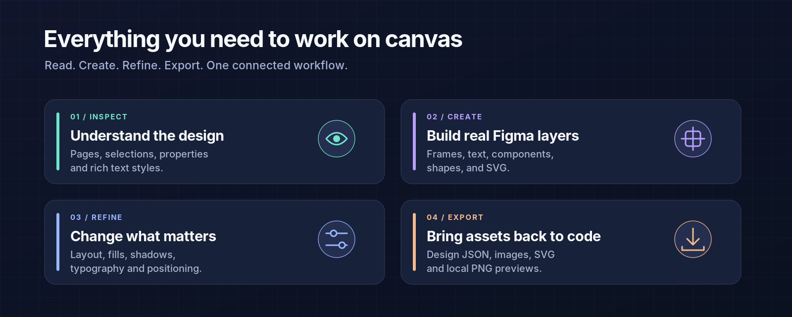
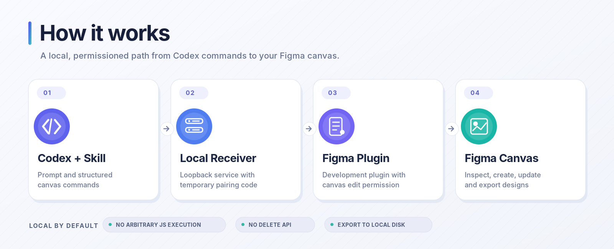

# Codex Canvas Bridge



[中文说明](README.md)

A local bridge that lets Codex read and edit your current Figma canvas through a desktop plugin. Create frames, text and components, adjust layouts and styles, import SVGs and images, and capture screenshots without configuring the official Figma MCP.

**Source available for noncommercial use only.** This project uses the [PolyForm Noncommercial License 1.0.0](LICENSE). It is not an OSI-approved open-source license. Commercial use is not granted. Third-party components retain their original licenses; see [THIRD_PARTY.md](THIRD_PARTY.md).

## Features



- Read the current page, selection, layer properties and styled text segments.
- Create frames, components, text, rectangles, ellipses and SVG nodes.
- Edit dimensions, positions, typography, fills, strokes, effects and Auto Layout.
- Clone and reparent layers, apply image fills and export PNG screenshots.
- Export design data, previews and assets to a local folder.

Commands are structured operations, not arbitrary JavaScript. There is no delete operation. Writes are not transactional: failures may leave partial changes. Timed-out writes are not automatically replayed.

## Quick start on Windows



Download the Windows x64 package from [Releases](https://github.com/XIFPASON/codex-figma-canvas-bridge/releases) and extract it completely. The package includes Node.js; no separate runtime installation is needed.

1. Run `start-receiver.cmd` and keep the terminal open. Data is saved under `design/figma` inside the tool folder by default.
2. In Figma Desktop, open **Plugins → Development → Import plugin from manifest** and select the package's `manifest.json`.
3. Run **Codex Canvas Bridge (Local)**, enter the connection code printed in the terminal, and click the green canvas connection button.
4. Run `install-skill.cmd` to install the companion skills, then open a new Codex chat.
5. Ask Codex:

```text
Use $figma-local-canvas to connect using <tool folder>/design/figma/.figma-bridge.json.
Read my current selection first.
```

Keep the plugin open while using canvas control. Reconnect after switching pages. Design export and canvas control are separate modes.

## Development

Requires Node.js 22 and npm. Tests also require Python 3.

```sh
npm ci
npm run typecheck
npm test
npm run build
npm run receive
```

Import the root `manifest.json` into Figma. To use another data directory, run `npm run receive -- --dir "path/to/folder"`.

`npm run package:release` builds a portable Windows x64 package. It requires Windows x64 and a matching Node.js license file under `licenses/`. A license file for Node.js v22.18.0 is included.

## Privacy and limitations

The service listens on the local loopback interface and authenticates requests with a temporary connection code. Do not share or commit `.figma-bridge.json`, which contains credentials. The tool does not upload designs to a cloud service by default.

Automated tests cover the service, CLI, simulated Plugin API, export handling and iframe compatibility. These tests do not replace end-to-end validation in real Figma files. Inspect the canvas before retrying a write whose outcome is unknown; use Figma Undo when needed.

This is a local development plugin, not a published Figma Community plugin. It is independently developed and is not affiliated with Figma or OpenAI.

Report issues through [GitHub Issues](https://github.com/XIFPASON/codex-figma-canvas-bridge/issues).
