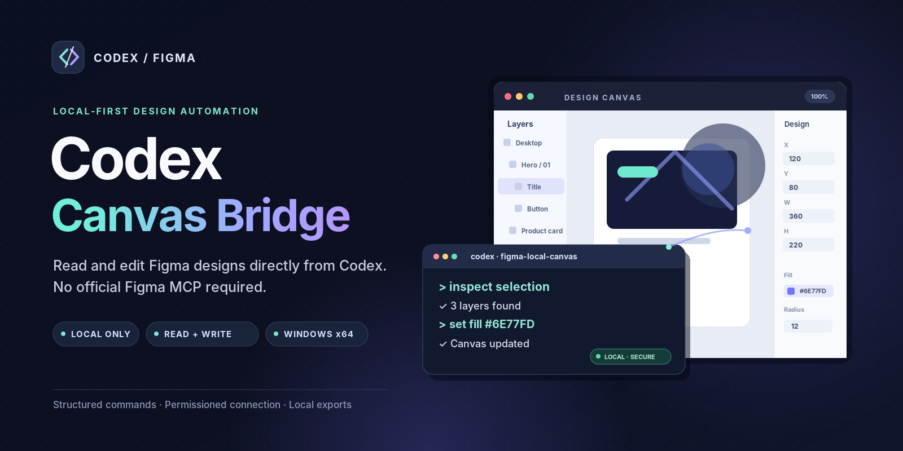
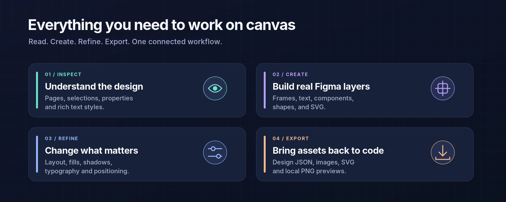
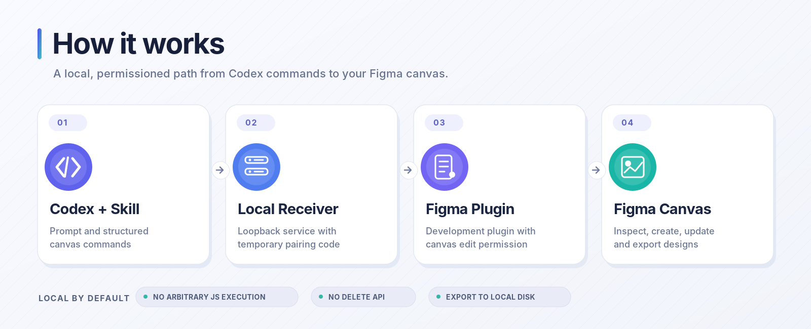

# Codex Canvas Bridge（本地版）



[English introduction](README.en.md)

**English:** A local bridge that lets Codex read and edit your current Figma canvas through a desktop plugin. Create frames, text and components, adjust layouts and styles, import SVGs and images, and capture screenshots without configuring the official Figma MCP. Source available for noncommercial use only.

通过本地插件，让 Codex 直接读取和编辑 Figma 当前页面。无需配置官方 Figma MCP，原有设计数据导出功能仍可使用。

**源码公开，仅限非商业用途。** 本项目采用 [PolyForm Noncommercial License 1.0.0](LICENSE)，不是允许商业使用的 OSI 标准开源项目。商业使用不在本许可授权范围内；完整条款以 LICENSE 为准。第三方组件保留其各自许可，见 [THIRD_PARTY.md](THIRD_PARTY.md)。

## 功能



- 读取当前页面、选区、图层属性和混合文字样式。
- 创建 Frame、文字、组件、矩形、椭圆和 SVG。
- 修改颜色、字体、尺寸、位置、Auto Layout、圆角和阴影。
- 复制图层、更换父级、设置图片填充、导出 PNG 截图。
- 将设计 JSON、预览、图片和 SVG 同步到本地。

使用结构化命令，不执行来自客户端的任意 JavaScript。没有删除接口。写命令并非事务，失败可能留下部分改动；超时不自动重放，以免重复创建。

## Windows 免安装包



从本仓库 [Releases](https://github.com/XIFPASON/codex-figma-canvas-bridge/releases) 下载并完整解压 Windows x64 包，无需安装 Node.js。

1. 双击 `start-receiver.cmd`。默认数据目录为工具文件夹中的 `design/figma`；保持终端开启。
2. Figma 桌面版 → Plugins → Development → Import plugin from manifest，选择解压目录的 `manifest.json`。
3. 运行 **Codex Canvas Bridge (Local)**，填入终端连接码，点击 **连接并允许画布编辑**。
4. 双击 `install-skill.cmd`，安装配套 Skill；新开 Codex 聊天。
5. 发送：

```text
使用 $figma-local-canvas，连接「工具目录/design/figma/.figma-bridge.json」，先读取当前选区。
```

仅导出设计时使用“同步到本地项目”或 ZIP 导出；与画布控制是两个入口。切换页面后需重新连接。

## 源码运行

需要 Node.js 22、npm，测试还需要 Python 3。

```powershell
npm ci
npm run typecheck
npm test
npm run build
npm run receive
```

导入根目录 `manifest.json` 即可运行。可用 `npm run receive -- --dir "其他保存目录"` 指定路径。

`npm run package:release` 构建 Windows x64 免安装包；需在 Windows x64 上运行，并提供与当前 Node 版本对应的 `licenses/Node-v版本-LICENSE.txt`。仓库已附 v22.18.0 的许可证。不要把 node_modules、口令配置或用户设计数据提交到仓库。

## 状态与故障排查

- 未连接：确认运行的是新版插件，并点击绿色画布连接按钮，不能只点击同步导出。
- 按钮无响应：已加入 Figma iframe 缺少 crypto.randomUUID 的兼容处理；更新文件后需关闭并重新运行插件。
- 端口占用：关闭旧版接收服务，再运行新版。
- 命令超时或结果未知：先查看画布/读取节点，再决定后续操作，不自动重复写命令。
- 部分修改失败：错误会返回可能受影响的节点；必要时在 Figma 撤销。

已覆盖服务、CLI、模拟 Plugin API、导出、资源安全检查与 UI 兼容性测试。模拟测试不等于真实 Figma 端到端验证；画布写入仍需在你的实际文件中确认。

## 数据和使用范围

服务只监听本机回环地址，使用临时连接码验证请求。`.figma-bridge.json` 含凭据，请勿分享或提交 Git。默认不上传设计至云服务；关闭插件或断开控制后不再接收编辑命令。

本仓库以本地开发插件为主，未发布到 Figma Community。`publishing/` 和 `output/community` 构建属于离线导出候选方案，不代表通过官方审核。请遵守 Figma 相关规则及设计素材使用权。

问题反馈：[GitHub Issues](https://github.com/XIFPASON/codex-figma-canvas-bridge/issues)。
